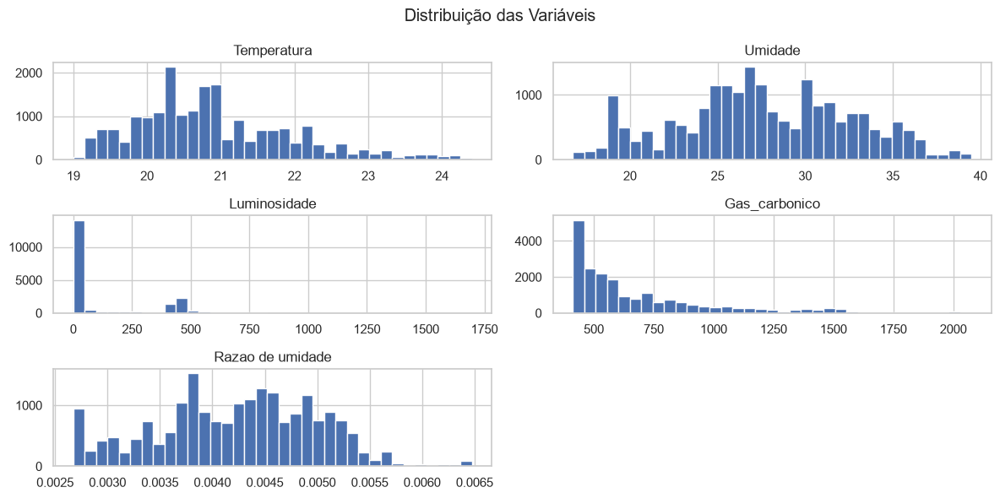
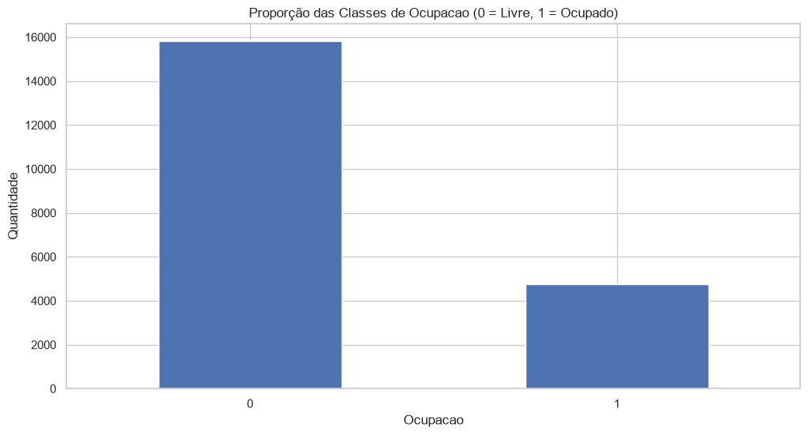
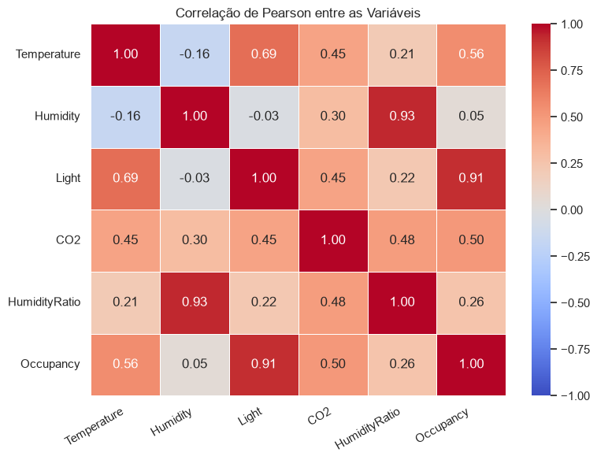
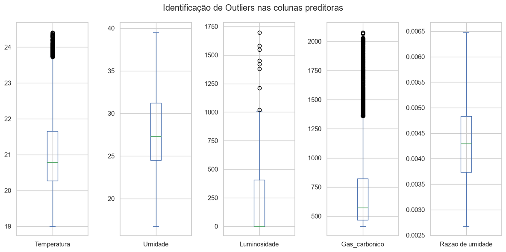

## Detecção de Ocupação Predial com Machine Learning
### Esse é um projeto avaliativo do Modulo 3 (Integração de IA com dados) do curso de Análise de Dados do SCTEC.

#### Aluno: Gustavo Giacomini

Atuaremos como um Cientista de Dados para estruturar um Pipeline Preditivo completo aplicado à Automação Predial e Eficiência Energética na Indústria 4.0.

### 1. O Problema: 

Um complexo industrial e tecnológico equipado com sensores ambientais IoT necessita prever em tempo real se determinadas salas técnicas e escritórios operacionais estão ocupados ou vazios, visando automatizar o desligamento inteligente de sistemas de ar-condicionado (HVAC) e iluminação para reduzir custos energéticos. A variável alvo do projeto é binária: Occupancy = 1 (ambiente ocupado / ativo) e Occupancy = 0 (ambiente desocupado / inativo).

#### Base de Dados: Occupancy Detection Dataset (UCI Machine Learning Repository / Kaggle),composta pelas seguintes variáveis ambientais:
- Temperature: Temperatura do ambiente em graus Celsius (°C).
- Humidity: Umidade relativa do ar (%).
- Light: Nível de luminosidade medido pelo sensor (Lux).
- CO2: Concentração de dióxido de carbono no ar (ppm).
- HumidityRatio: Taxa derivada de umidade específica e temperatura.
- Occupancy (Variável Alvo): Indicador binário de presença (0 = Desocupado, 1 = Ocupado).

#### Link para download dos dados: 
"https://archive.ics.uci.edu/ml/machine-learning-databases/00357/occupancy_data.zip"

#### Tecnologias usadas

- Python (pandas, numpy, matplotlib, seaborn, scikit-learn)
- Jupyter notebook
- GitHub e GitHub desktop

#### Como executar

- Clonar o repositorio.
- Criar e ativar ambiente virtual.
- Instalar as dependencias.
- Abrir o notebook e executar as celulas em ordem.

### 2. Análise Exploratória (EDA) e preparaçao

- A base de dados contém 20560 linhas e 7 colunas.
- Nenhum valor nulo foi identificados nas colunas.
- Foram identificados 1.441 registros duplicados, restando 19.119 amostras únicas.
- A coluna date foi descartada. Queremos que o modelo aprendam com as relaçoes entre os sensores, e não com horários fixo de expediente.

#### Graficos de distribuiçao

##### Distribuicao variaveis preditoras

##### Proporcao das classes da variavel alvo

##### Correlaçao de Pearson entre as variáveis

##### Identificaçao de Outliers.

#### Análise dos Resultados.

- A distribuiçao da variavel alvo reflete o dia a dia do edificio (madrugadas e finais de semana em que as salas permanecem vazias). Esse comportamento gera o deslanceamento dos dados (77% dos registros sao com salas vazias e 23% com salas ocupadas) exige que a divisão entre treino e teste seja estratificada (stratify=y).
- Com 91% de correlaçao com a ocupaçao, a luminosidade é o indicador mais forte da base. Os graficos mostram um grande volume de registros em 0 Lux (luzes apagadas) e um salto para valores elevados quando há ocupação. Contudo, a presença de outliers, como luz solar ou luzes esquecidas acesas, mostra que uma regra baseada apenas em luminosidade geraria falsos positivos, exigindo o apoio de variaveis secundarias.
- CO2 e Temperatura sao ao variaveis secundarias que confirmam a presenca de pessoas nas salas, pois se correlacionam 50% e 56%, respectivamente, com a ocupacao.
- Gas carbonico tem a maior concentracao de outliers, existem muitos pontos acima do limite superior (aproximadamente 1300), com valor maximo proximo a 2000.
- Temperatura tem uma leve assimetria para cima, a grande maioria das mediçoes esta na dentro da faixa de 20 a 22 graus.
- Umidade e Razao da umidade nao tem outliers, os dados sao simétricos, confirmando que essas variaveis tem pouca relaçao com a ocupaçao da sala.

#### Estrategia de modelagem

A árvore de decisao é a melhor escolha para esse conjunto de dados, as vantagens são:

- funciona como um fluxograma de perguntas (Regras Condicionais).
- Dispensa normalização (igualar escala)
- O modelo nao se confunde com colunas quase repetidas, por exemplo umidade e razao de umidade (correlacao de 93% entre elas)
- Um modelo que sempre chutasse 0 na ocupacao, teria quase 77% de acuracia, por isso deve-se tambem usar a matriz de confusao para monitorar os falsos positivos (luz solar) e falsos negativos (inicio do expendiente, quando a luz esta acesa mas o CO2 ainda baixo)

### 3. Criaçao de features 

Foram criadas 2 features a partir das variaveis existentes, para incorporar ao modelo. Sao elas:

- indice_calor_umidade: calculada multiplicando Temperature por Humidiy. Teve uma correlacao de 0.2131 com a ocupacao, podendo ser classificada como fraca, mas pode ser util quando combinada com outras variavies.
- razao_co2_lux: calculada dividindo o CO2 por Light + 1. Teve um correlacao de 0.5788 com a ocupacao, podendo ser classificada como moderada. Ela capturou um sinal relevante para ajudar o modelo.

### 4. Divisao e balanceamentos dos dados.

- Os dados foram divididos em 80% treino e 20% teste, usando random_state=42 e stratify=y.
- A divisao e balanceamento dos dados deve ser feito antes da normalizacao, padronizacao/escalonamento, imputacao pela mediana/media.

### 5. Escalonamento (StandardScaler)

- Os dados foram escalonados no modelo KNN, aplicando fit_transform na base de treino e transform na base de testes. Sem o StandardScaler, variáveis com números grandes (como CO2 até 2.000 e Luz até 1.600) dominam o cálculo da distância, fazendo o modelo ignorar variáveis de escala menor.
- Para a arvore de decisao nao precisa de padronizacao pois cada coluna é analisada separadamente, através de perguntas condicionais (ex: A temperatura é maior que 22?). Por isso, nao faz diferença se existir diferenca de escala entre as colunas.

### 6. Ajuste de parametros.

Testamos os 2 modelos com parametros 3, 5, 7, 13 e None(esse ultimo apenas para a arvore de decisao).

- No modelo knn, com os valores de k 3, 5, 7, 13, não teve overfitting, pois a diferença entre treino e teste foi muito pequena. k = 3 teve a maior diferença (0.1373). O melhor equilibrio ocorre em k=5 - tem a melhor acuracia no teste (99.4770%) com desempenho praticamente igual ao treino (99,4508%). Quando consideramos muitos vizinhos, como no k=13, as fronteiras de decisao ficam suavizadas, reduzindo o percentual de acuracia.
- No modelo Arvore de decisao vemos o maior overfitting em max_depth=None (sem limite de profundidade). Como nao tem limite Osde profundidade a arvore cria regras para cada linha da base, alcança 100% no treino, mas reduzindo para 99.0847% no teste. Os limites impostos no max_depth= 3 e 5 impede que a árvore decore ruídos, garantindo maior capacidade de generalizaçao para dados futuros.

### 7. Avaliaçao da acuracia e Veredito final

Os modelos KNN com k=5 e Arvore de decisao com max_depth=5 foram os melhores modelos encontrados na Fase 6,  considerando se o modelo nao é simples demais para capturar todas as regras dos dados.

Para classfica-los como os dois melhores modelos, usamos dois criterios, 
   - Maior acurácia no teste.
   - Menor diferença entre treino e teste.

### 8. Conclusao tecnica

- Comparação Numérica: Nos dados inéditos de teste, tanto o KNN (`n_neighbors=5`) quanto a Árvore de Decisão (`max_depth=5`) alcançaram excelente capacidade preditiva, com acurácia em torno de 99%, demonstrando que as variáveis ambientais (`Light`, `CO2`, `Temperature`, `Humidity`, `HumidityRatio`) somadas às features criadas (`indice_calor_umidade` e `razao_co2_luz`) explicam com alta precisão o status de ocupação da sala.

- Modelo Recomendado para Produção (`DecisionTreeClassifier`): Recomenda-se a adoção da Árvore de Decisão (`max_depth=5`) pelo sistema de automação predial pelos seguintes motivos técnicos e operacionais:
  1. Resume tudo em 5 condicionais simples, gasta muito menos memoria, se tornando barato.
  2. Nao precisa de escalonamento/padronizacao. O modelo lê os numeros direto dos sensores.
  3. As regras de decisão são auditáveis pela equipe de engenharia predial, facilitando a manutenção e o ajuste do sistema de climatização e iluminação.